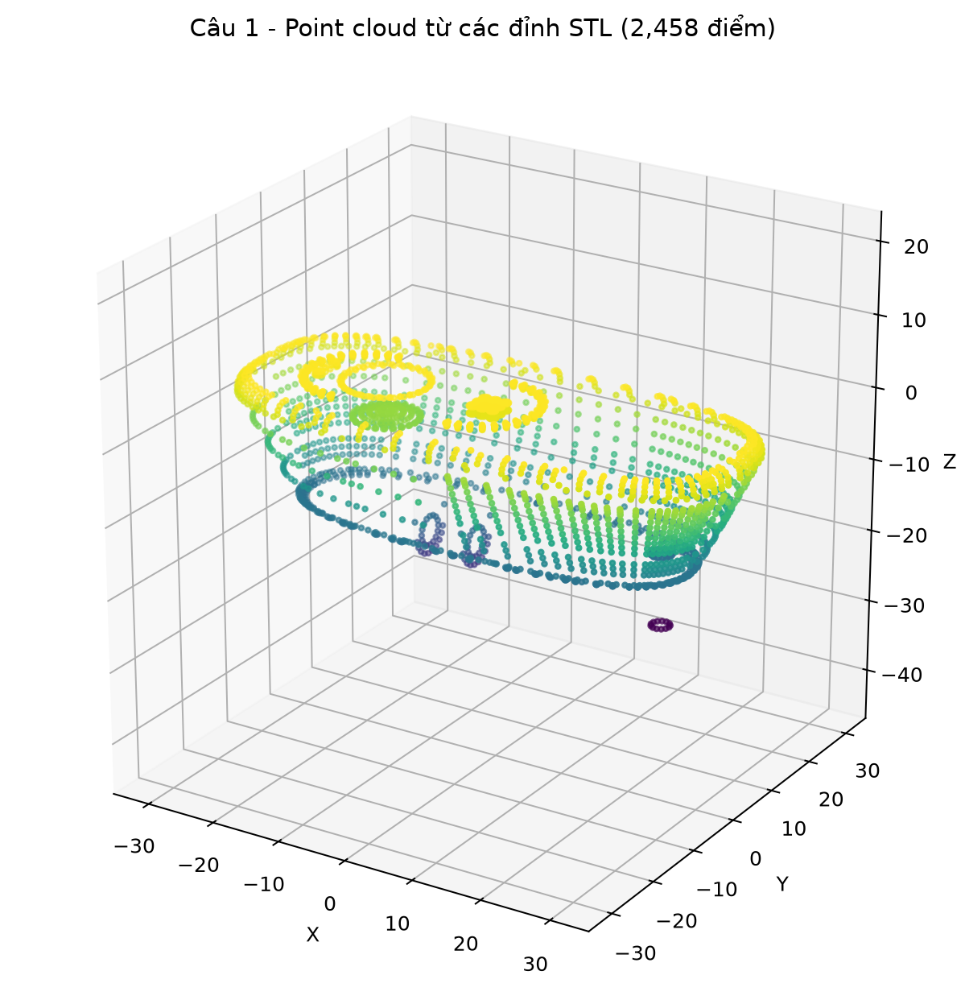
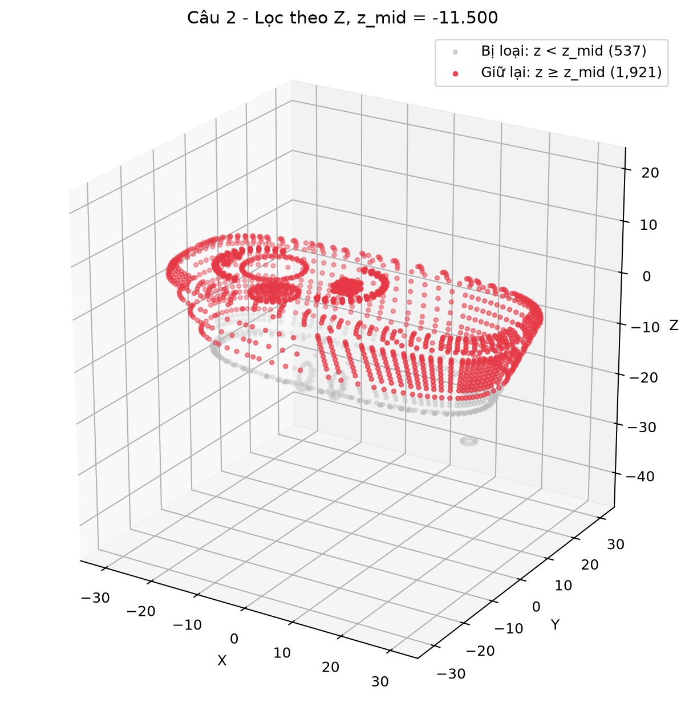
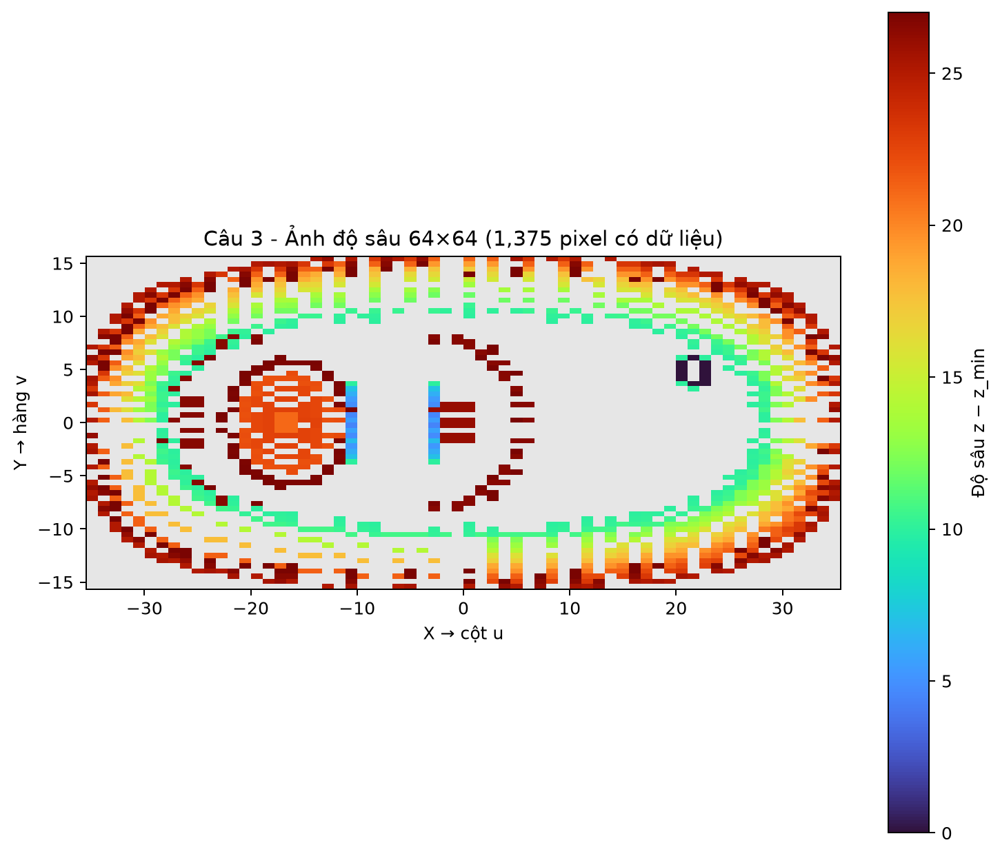
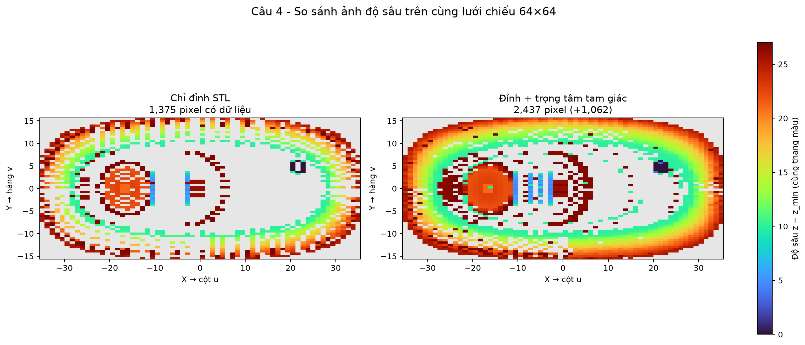

# Bài thực hành số 7 — Xử lý mô hình 3D và ảnh độ sâu

Repository thực hiện bài thực hành tuần 7 môn **Xử lý ảnh – Thị giác Robot** với mô hình 3D **Logitech C270** ở định dạng STL.

## Mục tiêu

Từ mô hình STL, chương trình thực hiện lần lượt:

1. Đọc Triangle Mesh và tạo đám mây điểm từ các đỉnh.
2. Loại bỏ những điểm có tọa độ trùng nhau.
3. Lọc đám mây điểm theo tọa độ Z.
4. Chiếu point cloud lên ảnh độ sâu `64 × 64`.
5. Bổ sung trọng tâm của mỗi tam giác và đánh giá mức tăng mật độ ảnh độ sâu.

## Nội dung từng câu

### Câu 1 — Tạo đám mây điểm từ STL

- Đọc STL binary hoặc ASCII và in số tam giác.
- Gộp các đỉnh tam giác thành mảng `N × 3`.
- Loại các hàng trùng bằng `numpy.unique`.
- Hiển thị point cloud bằng scatter 3D.

### Câu 2 — Lọc theo tọa độ Z

- Tính `z_min`, `z_max` và `z_mid`.
- Giữ các điểm thỏa mãn `z ≥ z_mid`.
- Dùng hai màu để phân biệt điểm giữ lại và điểm bị loại.

### Câu 3 — Tạo ảnh độ sâu

- Chia miền X–Y thành lưới `64 × 64`.
- Ánh xạ X thành cột `u`, Y thành hàng `v`.
- Khởi tạo depth map bằng `NaN`.
- Camera nhìn theo `+Z`; mỗi pixel giữ giá trị `z - z_min` nhỏ nhất.

### Câu 4 — Bổ sung điểm trên bề mặt

- Tính trọng tâm của từng tam giác.
- Ghép trọng tâm vào point cloud ban đầu.
- Chiếu lại trên cùng lưới và cùng thang màu.
- So sánh số pixel có dữ liệu trước và sau khi bổ sung.

## Cấu trúc repository

```text
XLA_th7/
├── Logitech c270.stl              # Mô hình 3D đầu vào
├── week7_3d.py                    # Chương trình chính
├── requirements.txt               # Thư viện cần cài đặt
├── README.md                      # Hướng dẫn sử dụng
└── output/
    ├── cau1_point_cloud.png
    ├── cau2_loc_z.png
    ├── cau3_depth_64x64.png
    ├── cau4_depth_comparison.png
    └── ket_qua_va_nhan_xet.txt
```

Các file báo cáo Word/PDF và file tạm không được đưa vào repository.

## Yêu cầu môi trường

- Python 3.10 trở lên.
- NumPy.
- Matplotlib.

## Cài đặt

Clone repository và chuyển vào thư mục dự án:

```bash
git clone https://github.com/23020734-thiendac/XLA_th7.git
cd XLA_th7
```

Cài đặt thư viện:

```bash
python -m pip install -r requirements.txt
```

## Chạy chương trình

Chạy với file `Logitech c270.stl` mặc định:

```bash
python week7_3d.py
```

Chương trình sẽ mở bốn cửa sổ kết quả 3D/ảnh độ sâu. Có thể kéo chuột để xoay point cloud và dùng con lăn để phóng to hoặc thu nhỏ.

Chỉ xuất kết quả, không mở cửa sổ đồ họa:

```bash
python week7_3d.py --no-show
```

Xem các tham số hỗ trợ:

```bash
python week7_3d.py --help
```

Có thể chỉ định một file STL khác:

```bash
python week7_3d.py "duong_dan/mo_hinh.stl"
```

## Kết quả với Logitech C270

| Nội dung | Kết quả |
|---|---:|
| Số tam giác | 4.916 |
| Số điểm trước loại trùng | 14.748 |
| Số điểm sau loại trùng | 2.458 |
| `z_min / z_max / z_mid` | `-25 / 2 / -11,5` |
| Số điểm giữ lại / bị loại | 1.921 / 537 |
| Pixel depth ban đầu | 1.375 / 4.096 |
| Pixel sau bổ sung trọng tâm | 2.437 / 4.096 |
| Số pixel tăng thêm | 1.062 (77,24%) |

## Hình kết quả

### Point cloud từ các đỉnh STL



### Lọc point cloud theo Z



### Ảnh độ sâu 64 × 64



### So sánh trước và sau khi thêm trọng tâm


